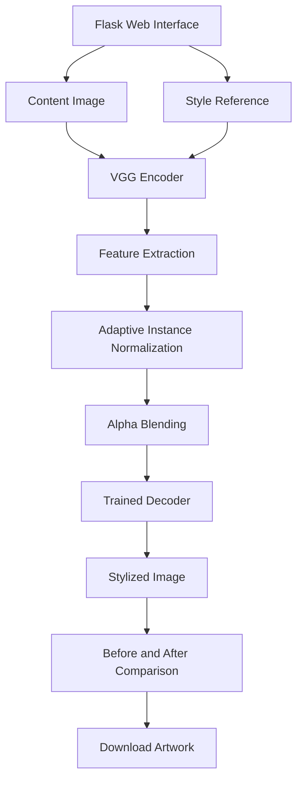

# AETHERA — Neural Style Transfer Studio 🎨

**Art, Reimagined by Intelligence.**

AETHERA is an AI-powered Neural Style Transfer application that transforms ordinary photographs into artistic creations using **Adaptive Instance Normalization (AdaIN)** and deep learning.

It combines the content of one image with the artistic characteristics of another, generating visually expressive results while allowing users to control the intensity of the style transformation.

<p align="center">
  
  
  
  
</p>

---

## ✨ Project Overview

AETHERA uses a deep learning-based approach to transfer artistic characteristics from a reference image onto a content image.

Whether it's transforming a photograph into a painting, applying sketch-like effects, or experimenting with different artistic references, AETHERA makes neural style transfer accessible through an interactive web interface.

## 🚀 Key Features

- **Neural Style Transfer:** Generate artistic images using the AdaIN algorithm.
- **Dual Image Upload:** Upload a content image and a separate style reference.
- **Adjustable Style Strength:** Control the transformation using an alpha slider.
- **Live Image Previews:** Preview uploaded images before processing.
- **Before-and-After Comparison:** Interactively compare original and stylized images.
- **Sample Gallery:** Explore example artistic transformations.
- **Downloadable Results:** Save generated artwork directly to your device.
- **Transformation History:** Access recent transformations through browser-local history.
- **Responsive Interface:** Designed for an intuitive experience across screen sizes.

## 🧠 Technical Approach

AETHERA implements **Adaptive Instance Normalization (AdaIN)** for arbitrary neural style transfer.

The pipeline consists of four main stages:

1. **Content Encoding:** A pretrained VGG encoder extracts feature representations from the content image.
2. **Style Encoding:** The encoder extracts feature representations from the style reference.
3. **Adaptive Instance Normalization:** Content features are normalized and adjusted using the channel-wise mean and standard deviation of the style features.
4. **Image Decoding:** A trained decoder reconstructs the stylized image from the transformed feature representation.

### Style Blending

The application provides an adjustable alpha parameter to control the intensity of the artistic transformation.

\[
t = \alpha \cdot AdaIN(f_c,f_s) + (1-\alpha)\cdot f_c
\]

Where:

- \(f_c\): Content image features.
- \(f_s\): Style image features.
- \(AdaIN(f_c,f_s)\): Adaptive Instance Normalization output.
- \(\alpha\): Style strength parameter between 0 and 1.

A higher alpha value produces a stronger style influence, while a lower value preserves more of the original content representation.

## 🏗️ System Architecture



## 🛠️ Technology Stack

| Category | Technologies |
|---|---|
| Programming Language | Python |
| Deep Learning | PyTorch |
| Computer Vision | Torchvision, Pillow |
| Neural Style Transfer | Adaptive Instance Normalization |
| Feature Extraction | VGG Encoder |
| Backend | Flask |
| Frontend | HTML, CSS, JavaScript |
| Templating | Jinja2 |
| Version Control | Git, GitHub |

## 📂 Project Structure

```text
NST-AdaIN/
│
├── app.py
├── train.py
├── requirements.txt
├── README.md
│
├── vgg_normalised.pth
│
├── experiment/
│   └── final_exp/
│       └── decoder_final.pth
│
├── utils/
│   ├── models.py
│   └── utils.py
│
├── templates/
│   └── index.html
│
├── static/
│   └── uploads/
│
├── content_data/
├── style_data/
└── examples/
```

## 💻 Run Locally

AETHERA can be run locally to experience the complete neural style transfer workflow.

After setting up the Python environment and installing the dependencies listed in `requirements.txt`, start the Flask application:

```bash
python app.py
```

Open the application in your browser:

```text
http://127.0.0.1:5000/
```

Upload a content image and style reference, adjust the style strength, generate your artwork, compare the results and download the final image.

## 🔬 Model Architecture

AETHERA follows an encoder–AdaIN–decoder architecture.

- **VGG Encoder:** Extracts deep feature representations from input images using pretrained weights.
- **AdaIN Module:** Aligns the channel-wise feature statistics of the content representation with those of the style representation.
- **Decoder:** Reconstructs the transformed feature representation into the final stylized image.

This approach supports arbitrary style transfer without requiring a separately trained model for every artistic reference.

## 📈 Future Enhancements

- High-resolution image generation.
- Optimized inference and faster processing.
- Support for additional image formats.
- Additional artistic presets and style references.
- Improved image-processing performance.
- Scalable cloud deployment.
